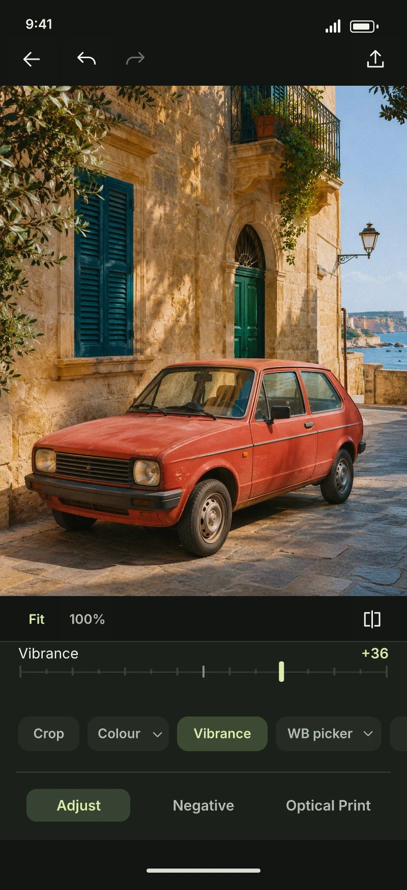
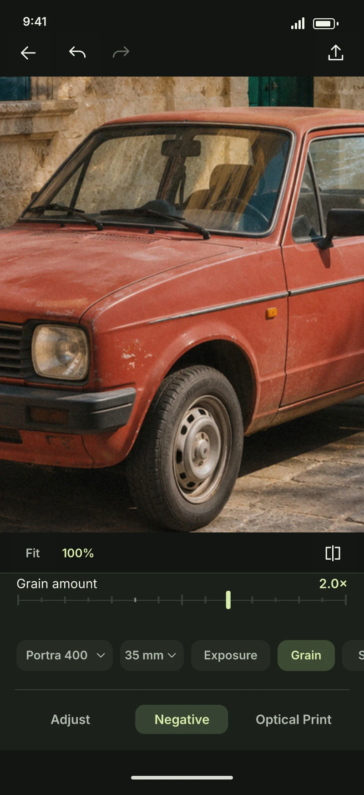
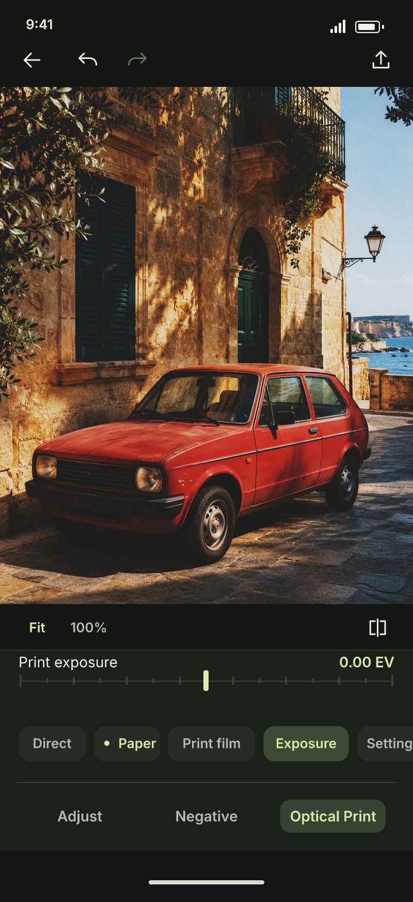

# Grainlegit

Grainlegit brings Filmgrain’s colour-negative and optical-print simulation to Android. It opens JPEG and HEIF photos, edits them on-device, and exports full-resolution sRGB JPEGs.

## Android designs

<p align="center">
  <a href="design/previews/adjust.webp"></a>
  <a href="design/previews/grain.webp"></a>
  <a href="design/previews/optical-print.webp"></a>
  <br>
  <sub>FigCraft prototype · Adjust, grain at 100%, and optical print on paper</sub>
</p>

- The interactive prototype covers photo picking, the editor, crop, and export. Open it in FigCraft and use Present mode. Choose **Open photo and edit** to start at Recent edits, or **Try the editor** to go straight to Adjust. [Android editor prototype](design/android-editor.figcraft)
- The implementation plan describes the Vulkan renderer, preview scheduling, tiled export, and Xiaomi 17 Ultra performance targets. [Android implementation plan](PLAN.md)

### Android editor

| Area | In the Android app |
| --- | --- |
| Recent edits | Open JPEG and HEIF photos through the Android photo picker. Reopen recent photos with their saved settings and grain seeds. |
| Preview and Adjust | **Fit**, **100%**, pinch and pan, hold-to-compare, undo and redo, and Light/Colour/Detail tools. The active adjustment stays visible while the remaining tools scroll. Curves and white balance preview changes before **Apply**. |
| Crop | Resize with the corner handles or drag to reposition. Choose an aspect ratio and adjust straightening, perspective, rotation, flips, or **Constrain**. The photo outside the crop is dimmed. |
| Negative | Choose the stock and one of six formats in dedicated sheets. Adjust camera exposure, grain amount, grain size, and grain colour independently. |
| Optical Print | Choose Direct, Paper, or Print film. The **Settings** sheet contains enlargement, enlarger blur, print grain, filtration, and scan optics. Direct scan exposes scan optics. |
| Export | Choose **Save copy** to start a full-resolution sRGB JPEG save with progress and cancellation. **Photo saved** confirms the export. |

### Remaining implementation plan milestones

- **Preview scheduling.** The GPU preview processes the latest requested edit and loads a full-resolution crop at 100% after the viewport settles. Speculative prefetch for nearby slider stops is still pending.
- **Device qualification.** Record Xiaomi 17 Ultra touch-to-display and settle times in both Fit and 100%, against the warm-edit targets of 100 ms for a grain-bearing update and 250 ms for a settled crop. Check sustained memory use, rotation, backgrounding, surface recovery, and framing during compare and at the edges of the 100% view. Other GPUs still need on-device qualification.
- **Import and export validation.** Add a checked-in wide-gamut HEIF decoder test. The renderer has desktop parity tests for viewport crops and tiles. The remaining Android checks include comparing the 100% preview with pre-encoding export pixels, documenting 12 MP and 50 MP end-to-end exports, and stress-testing 200 MP to determine the supported maximum.
- **Later rendering work.** RAW/DNG development and broader spectral colour modelling are planned follow-ups.

## Repository layout

| Path | Purpose |
| --- | --- |
| `android/` | Gradle project and Kotlin/Compose editor. Open this directory in Android Studio. |
| `renderer/` | Rust JNI renderer, `wgpu` pipelines, and WGSL shaders, with its own Cargo lockfile and toolchain. |
| `scripts/` | SDK setup, build, install, and native-library verification. Gradle invokes `build-android-native` when packaging the app. |
| `src/` | Portable Rust settings, defaults, and stock selection |
| `profiles/` | Emulsion parameters shared by Rust and the reference renderers, with [calibration sources and method](profiles/grain-calibration.md) |
| `reference/` | Python CLI and CPU model, Apple Silicon Metal renderer, calibration script, and renderer parity tests |

## Build and run on Android

Install a JDK (17 or 21), `rustup`, and Android SDK Command-line Tools (latest). Set `ANDROID_HOME` if your SDK is outside `~/Library/Android/sdk` on macOS or `~/Android/Sdk` on Linux. The Gradle wrapper downloads Gradle.

```sh
scripts/android setup      # API 36 SDK, pinned NDK, build tools, adb, and Rust Android target
scripts/android build     # android/app/build/outputs/apk/debug/app-debug.apk
scripts/android verify    # APK ZIP and arm64 ELF alignment for 16 KiB page devices
scripts/android devices   # check that adb sees the phone
scripts/android run       # build, install, and launch
```

The first device target is the Xiaomi 17 Ultra. Enable USB debugging, connect the phone, and accept its debugging prompt. Open a photo, tap **100%** for a source-pixel crop, and hold the half-circle button to see the original. Use **Fit** to return to the full frame.

The app keeps the original intact and saves recent edits and their seeds locally. Tap the export arrow, then **Save copy**, to save a JPEG to `Pictures/Grainlegit`. The exporter decodes and renders padded tiles and stages RGB rows in the app cache before encoding. Allow approximately three bytes of temporary disk space per output pixel, plus space for the JPEG. Cancelled exports remove their temporary files and any unpublished MediaStore entry.

Use `scripts/android logs` for the adapter and driver, Vulkan setup, and render-worker completion timings. The timing logs end at GPU completion. Collect an Android FrameTimeline/Perfetto trace for input-to-display measurements. Run the WGSL direct-scan, optical-print, and tile parity checks on macOS with `(cd renderer && cargo test --locked)`.

To reproduce the slider measurements on macOS, run `uv run --python 3.14 scripts/measure-renderer.py`. It renders a control chart through the same WGSL pipeline and saves the source chart, response diagrams, and CSV under `local/android-testing/`.

## Run the reference

```sh
cargo test --locked
uv run --python 3.14 reference/tests/test_metal.py
uv run --python 3.14 reference/filmgrain.py /path/to/photo.jpg --backend cpu -o /path/to/render.png
```

The tests use synthetic inputs. On Apple Silicon they also exercise Metal. To render a reference using Metal, pass `--backend metal` to the reference CLI. Pass `--print-medium paper` to render an optical print. Keep private test photos and local renders under `local/` or outside this repository.

## Provenance and license

The starting files came from the Filmgrain project in `album-turkey` at base commit `23c65d1`, including the working changes with the current stock profiles, crop handling, and preview renderer. [MIT](LICENSE) covers this project's original code and documentation. The profile calibration notes link to the external measurements. The scans, datasets, and manufacturer documents stay at their sources.

Run `uv run --python 3.14 scripts/dependency-notices.py` to inventory the resolved Android and Rust dependency licenses and collect Rust notice texts under `local/`. The encoder's sRGB ICC profile was generated with Little CMS.
