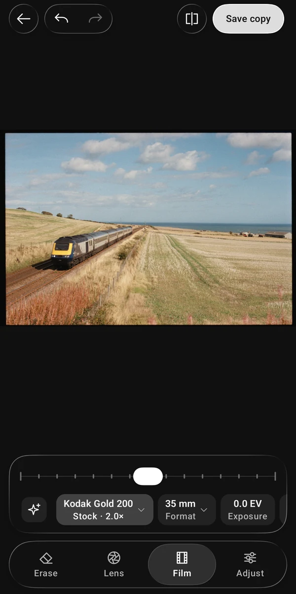
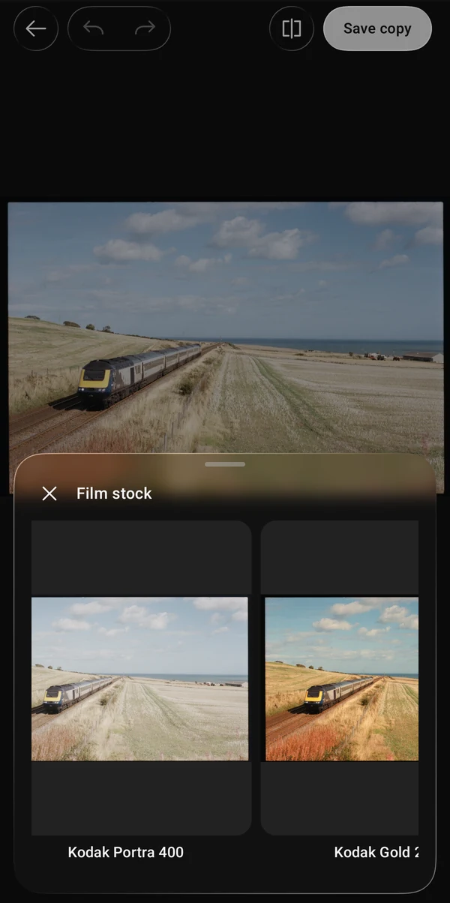
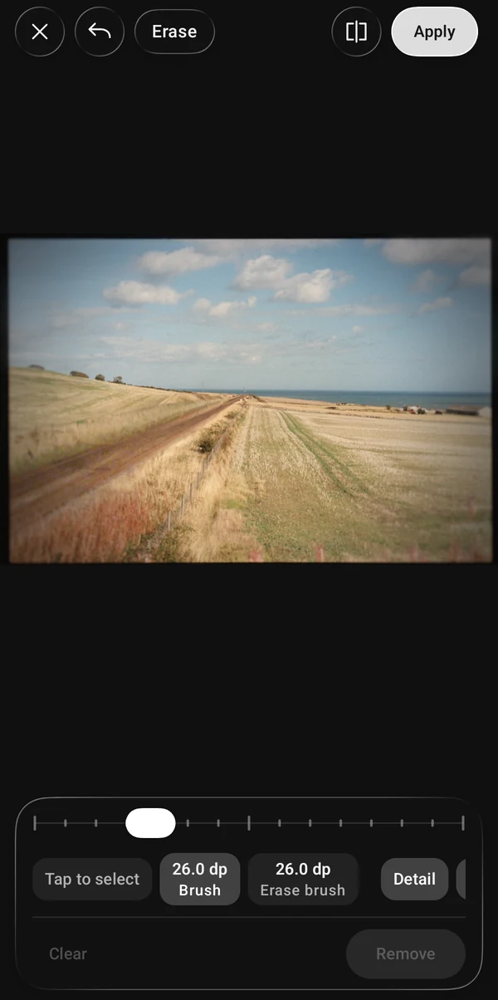
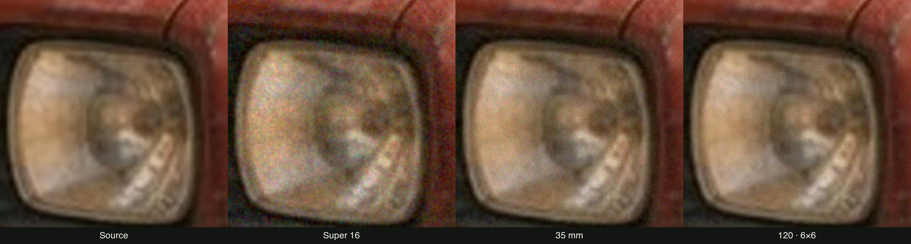
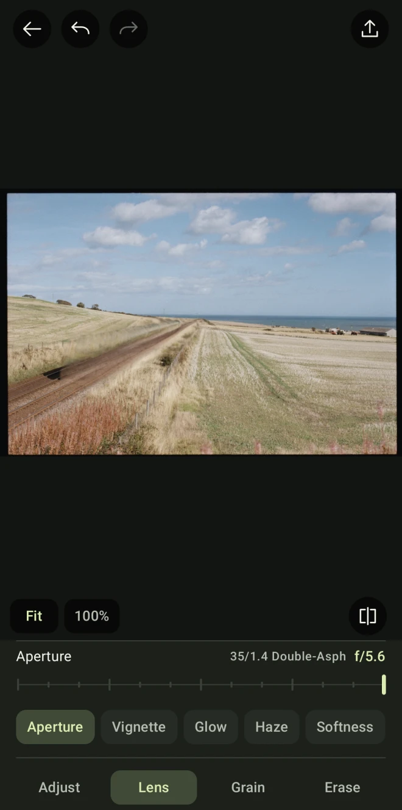
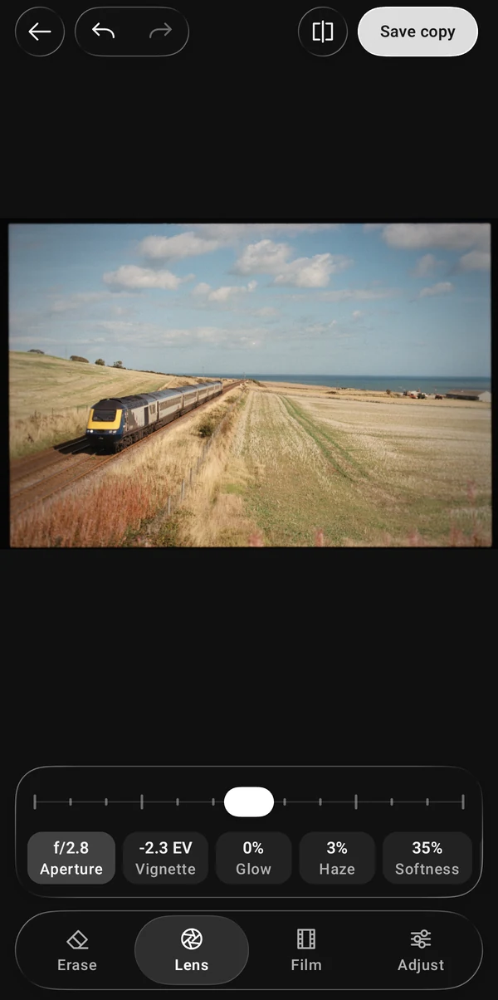
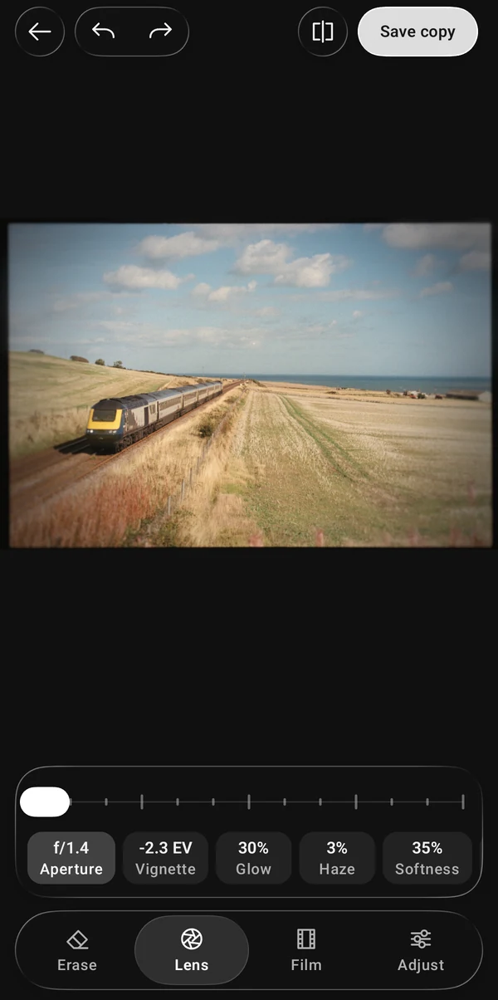

# Grainlegit

**Real film grain and real lens character, rendered live on your phone.**

Grainlegit doesn't lay a grain texture over your photo. It exposes the photo onto a simulated film negative, grows grain from dye clouds in each colour layer, and scans the result. All of this runs on the phone's GPU fast enough to follow your finger on a slider. Add an aperture-controlled lens look and AI object removal, all on the device, and your photos never leave the phone.

**[Download the latest APK](https://github.com/mir/grainlegit/releases/latest)** · Android 16 or later · built for Snapdragon 8 Elite Gen 5 (SM8850)

  
  
  
  
   
  Film, stock picker, Lens and Erase in Grainlegit 0.15 on a Xiaomi 17 Ultra.

## Why it looks real

- **Grain from physics, not a texture.** Each pixel becomes density on a negative. Denser areas grow more dye clouds, so the grain's texture changes naturally with tone and colour, just as it does on film.
- **Eight real film stocks.** Kodak Portra 160, 400 and 800, Gold 200, Ektar 100, UltraMax 400, Vision3 500T and Fujicolor Superia X-TRA 400. Each has its own grain, tone curve and colour, based on scan measurements and published data. [How the stocks were calibrated](profiles/grain-calibration.md)
- **Film format sets the grain.** Choose Super 16, 110, 35 mm, 120, 4×5 or 8×10. Grain is sized in micrometres on the film, so a smaller negative gives bigger grain, just like in a real camera.
- **What you see is what you save.** The preview and the full-resolution export use the same renderer and the same grain, down to each individual cloud.

  
  
   
  Top row: the source, then Portra 400 on Super 16, 35 mm and 120. Bottom row: Ektar 100, Portra 400, Gold 200 and Vision3 500T on 35 mm.

## A lens you control with the aperture

Open **Lens** and drag **Aperture** from f/5.6 toward f/1.4. Corners fall off and soften, the centre warms, and bright areas start to glow in the colour of their light. Fine-tune **Vignette**, **Glow**, **Haze**, **Softness** and **Edge warmth**, or turn up **Ghosts** for flare opposite the brightest highlight. The lens works before the film, so grain stays crisp even where the lens softens the image.

  
  
  
   
  The same photo at f/5.6, f/2.8 and f/1.4.

## Erase anything with on-device AI

Tap an object and SAM 3.1 selects it on the phone's NPU, or paint over it with the brush. A quick fill appears straight away, and then a more precise model refines it. Grainlegit copies full-resolution texture from the surroundings and matches the photo's grain, so the fill doesn't look smeared. For the best results, download the optional OSOR model (4.3 GiB). It also runs on the NPU.

## Everything else you need

- **Adjust:** crop, straighten, perspective, exposure, highlights, shadows, contrast, curves, white balance picker, colour and sharpening.
- **Liquid glass interface:** controls float over the photo as refracting glass, so more of the photo stays visible while you edit.
- **Hold to compare** with the original, pinch to zoom to 100%, and undo or redo any step.
- **Auto grain** ✦ picks a grain size that is just visible at your photo's size.
- **Recent edits** reopen with all their settings and the same grain.
- **Save copy** exports a full-resolution JPEG to `Pictures/Grainlegit`, with your film settings stored in the file. Your original photo is never changed.

## Film controls

| Control | What it does |
| --- | --- |
| **Stock** | Swipe through live previews of your photo on each stock. Strength runs from neutral at 0× through the real stock at 1× and beyond, for a stronger look. |
| **Format** | Smaller formats show bigger grain. |
| **Exposure** | Over- or underexpose the negative. |
| **Amount**, **Size**, **Strength** | How much grain there is, how coarse it is, and how much contrast it has. |
| **Tone** | Move grain into the shadows or the highlights. |
| **Colour** | From neutral grain to red, green and blue speckle. |
| **Dye per cloud**, **Coarse fraction** | Harsher, clumpier grain at the same density. |
| **Red / Green / Blue size** | Grain size per colour layer, such as grainier skies. |
| **Development** | Push for more contrast and grain, or pull for a softer look. |

## Install

Download the APK from the [latest release](https://github.com/mir/grainlegit/releases/latest) and install it. It updates over any previous Grainlegit install. You need Android 16 or later with Vulkan 1.3. The release is tuned for Snapdragon 8 Elite Gen 5 (SM8850), where selection and OSOR run on the NPU.

## For developers

Building, testing, releasing and the research notes are in [docs/DEVELOPMENT.md](docs/DEVELOPMENT.md).

## License

[MIT](LICENSE) covers this project's original code and documentation. The starting files came from the Filmgrain project in `album-turkey` at base commit `23c65d1`. The profile calibration notes link to the external measurements. Scans, datasets and manufacturer documents stay at their sources. Third-party notices ship with each release.
