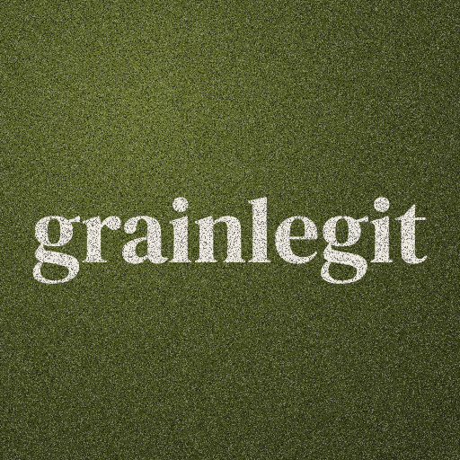
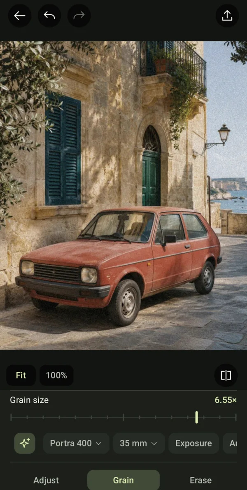
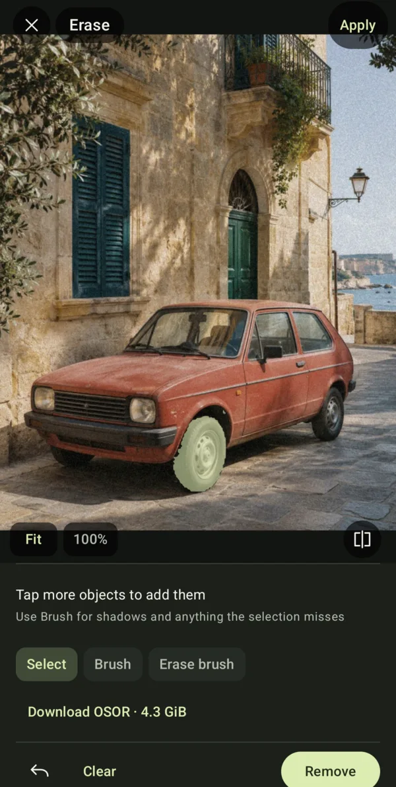
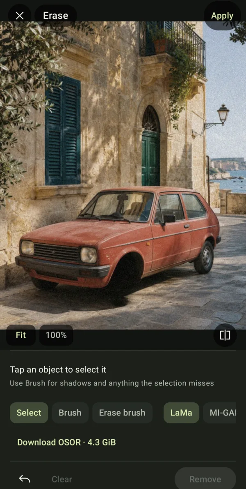
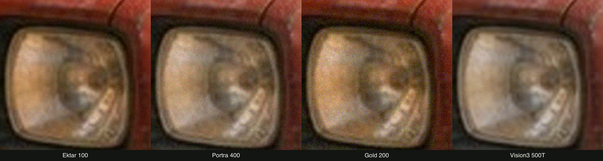

# Grainlegit



Grainlegit is an Android photo editor that grows film grain from the photo instead of laying a noise texture over it. Pick a real negative stock and a frame size. The app turns each pixel into dye density on a simulated negative, forms the grain from individual dye clouds, and scans the result. The GPU renders it live. On-device AI removes objects, and nothing is uploaded.

<p align="center">
  
  
  
  <br>
  <sub>Portra 400 on 35 mm · one tap selects the wheel · Remove fills it in, all on the phone</sub>
</p>

## Why it looks different from a grain slider

Most editors add grain by blending a fixed noise pattern over the photo. The pattern is the same in shadows and highlights, ignores film format, and changes size when the photo is resized. Grainlegit models what makes grain on film.

- **Grain comes from the image.** Each colour layer of the negative is built from many small dye clouds. Denser parts of the negative get more clouds, and the clouds land at random. So grain texture changes with tone and colour, the way it does on a scan.
- **Stocks are calibrated against published data.** Each stock has fine and coarse cloud sizes, dye loads, a tone curve and a colour balance for every layer. Their grain strength is fitted to scans and Kodak granularity data ([sources and method](profiles/grain-calibration.md)). For example, Gold 200's blue-sensitive layer measures about 2.4× the granularity of Ektar 100's, and the render keeps that difference.
- **Format sets the grain size.** Clouds are sized in micrometres on the negative, not in pixels. A 6000-pixel photo on 35 mm spreads 36 mm of film across those pixels, so each pixel covers 6 µm. Choosing Super 16 squeezes the same photo onto 12.5 mm and the grain grows about 3×. Choosing 120 makes it about 1.6× finer.
- **Preview and export match.** Each photo keeps its own grain seed, and the export runs the same GPU shaders in full-resolution tiles. The grain you see at 100% is the grain in the saved JPEG.

<p align="center">
  
  
  <br>
  <sub>Crops shown at 200% from the car photo upscaled to 4800 × 6000 and rendered with the reference renderer. Top row: the source, then Portra 400 on Super 16, 35 mm and 120. Bottom row: four stocks on 35 mm.</sub>
</p>

### What the Grain controls do

Take Portra 400 on 35 mm. Each control changes one physical property of the negative.

| Control | What it changes on the negative | What you see |
| --- | --- | --- |
| **Stock** | Cloud sizes, dye per cloud, tone curve and colour balance for each layer | Ektar is fine-grained and saturated; Gold 200 has strong grain in its blue layer |
| **Format** | Width of film the photo is spread across, from Super 16 to 8×10 | Smaller formats show larger grain |
| **Exposure** | Exposure of the negative before it is scanned | Moves tones along the stock's curve. Thin, underexposed areas look different from dense ones. |
| **Amount** | Clouds are larger and each carries more dye, with fewer of them for the same density | Stronger grain without changing tone |
| **Size** | Scales every cloud | Coarser or finer grain |
| **Colour** | How independently the three dye layers vary | 0% is neutral grain; 100% shows red, green and blue speckle. Default 25%. |
| **Dye per cloud** | Same density from fewer, denser clouds | Harsher, more contrasty grain at the same size |
| **Coarse fraction** | Share of density carried by the large clouds; **Use stock profile** keeps the stock's mix | Clumpier texture as it rises |
| **Red / Green / Blue size** | Cloud size in one layer | For example, enlarge the blue layer for grainier skies |
| **Development** | Push or pull: each layer's contrast and dye load | Push for more contrast and stronger grain, pull for softer results |
| **Auto** ✦ | Picks a grain size that is just visible on the phone at Fit | A good starting point for any photo size |

## On-device rendering and AI

- **GPU renderer.** A Rust engine runs WGSL compute shaders through `wgpu` on Vulkan. It draws a Poisson count of clouds at each site at twice the output resolution, blurs them with the cloud shapes, and averages the light the way a scanner would. The preview always renders the latest edit. At 100% it renders a full-resolution crop of the area on screen.
- **Erase with local AI.** Tap an object and SAM 3.1 selects it, or paint the area with the brush. MI-GAN shows a fill at once, then a more precise model replaces it: LaMa, or OSOR when installed. Fills get noise measured from the surrounding photo, so they don't read as smooth patches. On Snapdragon 8 Elite Gen 5 (SM8850), the precompiled SAM 3.1 encoder runs on the Hexagon NPU. OSOR is an optional removal model, a one-time 4.3 GiB download, that also runs on the NPU.
- **Private by default.** Photos never leave the phone. The original file is never changed. Exports go to `Pictures/Grainlegit` as full-resolution sRGB JPEGs.

### Android editor

| Area | In the Android app |
| --- | --- |
| Recent edits | Open JPEG and HEIF photos through the Android photo picker. Reopen recent photos with their saved settings and grain seeds. |
| Preview | **Fit**, **100%**, pinch and pan, hold-to-compare, and undo and redo. The controls float over the photo. |
| Adjust | Crop, exposure, tone, curves, white balance, colour and sharpening. Curves and white balance preview changes before **Apply**. |
| Crop | Corner handles, aspect ratios, straightening, perspective, rotation, flips and **Constrain**. |
| Grain | Stock, format, Auto and the controls above. |
| Erase | Tap objects or paint an area, then choose **Remove** and **Apply**. |
| Export | **Save copy** saves a full-resolution JPEG, with progress and cancellation. |

The [implementation plan](PLAN.md) covers the renderer design, preview scheduling, tiled export and performance targets. The [FigCraft prototype](design/android-editor.figcraft) holds the original editor design.

## Repository layout

| Path | Purpose |
| --- | --- |
| `android/` | Gradle project and Kotlin/Compose editor. Open this directory in Android Studio. |
| `renderer/` | Rust JNI renderer, `wgpu` pipelines, and WGSL shaders, with its own Cargo lockfile and toolchain. |
| `scripts/` | SDK setup, build, install, and native-library verification. Gradle invokes `build-android-native` when packaging the app. |
| `src/` | Portable Rust settings, defaults, and stock selection |
| `profiles/` | Emulsion parameters shared by Rust and the reference renderers, with [calibration sources and method](profiles/grain-calibration.md) |
| `reference/` | Python CLI and CPU model, Apple Silicon Metal renderer, calibration script, and renderer parity tests |

## Build and run on Android

Install a JDK (17 or 21), `rustup`, and Android SDK Command-line Tools (latest). Set `ANDROID_HOME` if your SDK is outside `~/Library/Android/sdk` on macOS or `~/Android/Sdk` on Linux. The Gradle wrapper downloads Gradle.

```sh
scripts/android setup      # API 36 SDK, pinned NDK, build tools, adb, and Rust Android target
scripts/ai-models          # stage the on-device AI Erase assets
scripts/android build     # android/app/build/outputs/apk/debug/app-debug.apk
scripts/android verify    # APK ZIP and arm64 ELF alignment for 16 KiB page devices
scripts/android devices   # check that adb sees the phone
scripts/android run       # build, install, and launch
```

The first device target is the Xiaomi 17 Ultra. Enable USB debugging, connect the phone, and accept its debugging prompt. Open a photo, tap **100%** for a source-pixel crop, and hold the half-circle button to see the original. Use **Fit** to return to the full frame.

The app keeps the original intact and saves recent edits and their seeds locally. Tap the export arrow, then **Save copy**, to save a JPEG to `Pictures/Grainlegit`. The exporter decodes and renders padded tiles and stages RGB rows in the app cache before encoding. Allow approximately three bytes of temporary disk space per output pixel, plus space for the JPEG. Cancelled exports remove their temporary files and any unpublished MediaStore entry.

### SM8850 release APK

Use the [SAM 3.1 ONNX export](https://huggingface.co/smile-forge/sam3.1-onnx/tree/47874a1f1d996211f6cc11bc6201a36af87a3fd6). Place `image-encoder.onnx`, `image-encoder.onnx.data`, and `click-decoder.onnx` together in a local model directory. With the QAIRT 2.52 x86-64 Linux libraries on `LD_LIBRARY_PATH`, run `uv run scripts/compile-sam31.py MODEL_DIR` to generate the context under `MODEL_DIR/sm8850`.

Build the unsigned APK with `android/gradlew -p android :app:assembleRelease`. Run `scripts/package-android-sm8850 MODEL_DIR OUTPUT_APK` to add the precompiled model, align and sign the APK. The script uses `release.p12` and `release.pass` in `${XDG_CONFIG_HOME:-$HOME/.config}/grainlegit`. Override the paths with `GRAINLEGIT_RELEASE_KEYSTORE` and `GRAINLEGIT_RELEASE_PASSWORD_FILE`.

On SM8850, open **Erase → Download OSOR** to install the Phase II removal model. It uses about 4.3 GiB of storage and runs on the phone's NPU. Once installed, Erase uses it for the precise fill.

For the model release assets, run `scripts/package-osor-sm8850 COMPILED_MODEL_DIR OUTPUT_DIR`. It checks the pinned context hashes before creating three packs with the [model license](android/app/src/main/assets/licenses/OSOR-SDXL-Model.txt) and [provenance notice](android/app/src/main/assets/licenses/OSOR-SDXL-NOTICE.txt).

Use `scripts/android logs` for the adapter and driver, Vulkan setup, and render-worker completion timings. The timing logs end at GPU completion. Collect an Android FrameTimeline/Perfetto trace for input-to-display measurements. Run the WGSL direct-scan, optical-print, and tile parity checks on macOS with `(cd renderer && cargo test --locked)`.

To reproduce the slider measurements on macOS, run `uv run --python 3.14 scripts/measure-renderer.py`. It renders a control chart through the same WGSL pipeline and saves the source chart, response diagrams, and CSV under `local/android-testing/`.

## Run the reference

```sh
cargo test --locked
uv run --python 3.14 reference/tests/test_metal.py
uv run --python 3.14 reference/filmgrain.py /path/to/photo.jpg --backend cpu -o /path/to/render.png
```

The tests use synthetic inputs. On Apple Silicon they also exercise Metal. To render a reference using Metal, pass `--backend metal` to the reference CLI. Pass `--print-medium paper` to render an optical print. Keep private test photos and local renders under `local/` or outside this repository.

## Provenance and license

The starting files came from the Filmgrain project in `album-turkey` at base commit `23c65d1`, including the working changes with the current stock profiles, crop handling, and preview renderer. [MIT](LICENSE) covers this project's original code and documentation. The profile calibration notes link to the external measurements. The scans, datasets, and manufacturer documents stay at their sources.

Run `uv run --python 3.14 scripts/dependency-notices.py` to inventory the resolved Android and Rust dependency licenses and collect Rust notice texts under `local/`. The encoder's sRGB ICC profile was generated with Little CMS.
